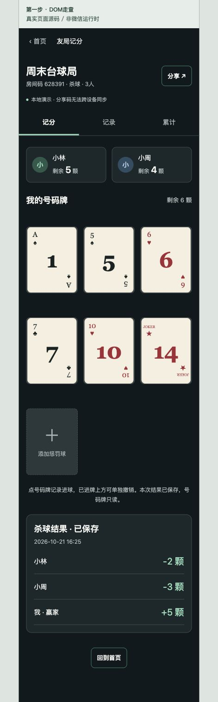

# 前端第二步：杀球

2026-10-21。依据 PRD 第5节、UI-UX 与 V4 handoff；沿用 Taro + React + Zustand。仅修改前端，不实现或部署云函数。

## 已交付

- 杀球房间接入准备名单、三人随机发牌、个人号码牌、其他参与者剩余数。
- 1—15号采用 V4 SVG，三列等宽；已进牌保留，撤销拥有独立44px命中区，每行预留48px间隔。
- 点本人未进牌记录进球；点已进牌不重复扣数；上方撤销恢复未进。
- 末尾＋打开1—15号选牌面板，本人号码禁选。确认转入同时更新双方，转入球恢复未进，保留初始归属。面板不展示其他人的号码列表、归属或进球状态。
- 选择赢家、核对并调整输家剩余数，保存一份完整零和结果；允许剩余数超过初始5颗，输入范围0—15整数。
- 保存后号码牌只读，记录和累计页展示已保存结果。重新进入恢复原分配、进球、转归与保存结果，不自动发新牌。
- 提交时禁用相关动作；成功后更新界面。失败保留上次确认状态；版本冲突刷新后重新确认；结果未知持久化原请求并支持同请求重试。

## 实现边界与复用

`features/kill/api.ts` 是前端杀球接口及持久化 Mock 适配器。UI只得到本人号码、各人剩余数、名单和结果；初始归属留在适配器内部。Mock 与房间数据分别存储，版本校验与幂等回执用于验证交互，不能替代服务器事务或跨设备同步。

`features/kill/store.ts` 使用 Zustand，管理当前房间、已确认快照、加载/提交状态及待确认操作。请求日志按环境、身份隔离；离开后旧查询不能重新打开旧页面。

`KillFeature.tsx` 负责名单、牌组、选球和结果面板；复用全局 BaseButton、ActionButton、BottomSheet、Notice、StatePanel。`features/cards/images.ts` 统一引用15张号码素材，避免页面自行拼造牌角。房间壳的分享、导航、标签页继续复用。

云端杀球契约尚不存在。本次不发明接口名、不修改 shared/backend；cloud 模式明确提示接口未接入，绝不切换到本地假保存。实时订阅、真实多人并发与真机网络验证未实现。

PRD P10 尚未确认四人少牌者、发牌权限、新一轮/重发入口。三人发牌仅作为本地演示开放给所选参赛者；云端权限不据此确定。四人入口、重新发牌与新一轮暂不开放。因此当前仅有一份可保存牌局，累计等于该份结果；尚不能验收 K02/K04/K06 的四人或多轮场景。P09 的转归回退亦未实现，进球撤销不撤销转归。

## 验证

- 前端 TypeScript 检查通过，微信小程序生产构建通过。
- 19项自动测试通过（原房间11项、杀球8项），覆盖15张完整唯一、重开不换牌、重复请求、个人权限、撤销、两种转归计数、初始归属保留、版本冲突、失败写入、零和保存、只读保护、未知响应恢复，以及旧页面响应隔离。
- DOM交互走查：发牌后本人5颗；进球5→4，撤销4→5；转入1号本人5→6，小周5→4；刷新保留转入；手动填写输家2/3，保存并在累计页显示+5/−2/−3。
- 320px内容宽检查：牌组无水平溢出，牌等宽88px。390px内容宽牌约111px。此处为浏览器开发走查，不属于微信运行时或真机验收。
- 微信开发者工具窗口在本轮走查时不可用，未完成新增杀球页面的微信运行时视觉验收。构建产物已更新，可在工具内重新编译查看。

本地体验：默认 Mock 模式，加入示例房间码628391，确认三人名单后发牌。当前设备已保存结果时恢复只读，勿把它误认为未响应；新一轮尚未开放。

