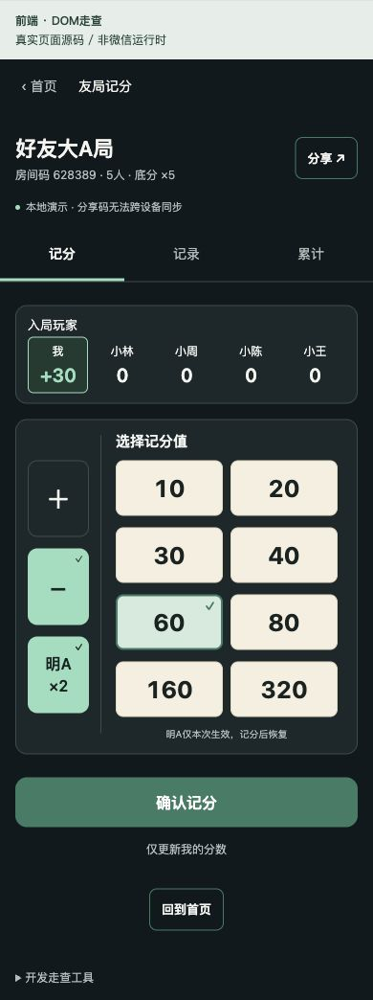
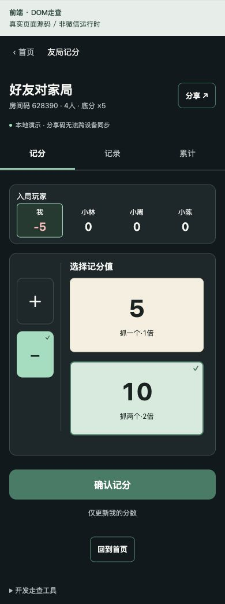

# 前端第三步：两种扑克个人快捷记分

2026-10-21。依据 [扑克 V4 最终开发规格](../design/poker-v4-handoff/SPEC.md)、对应 SVG 和 PRD 第7—9节。旧版五人系数表、两名赢家、全员零和保存、计算预览均不适用本次实现。

## 已实现及验收方法

| 功能 | 可验收行为 |
| --- | --- |
| 扑克创建 | 首页选择打大A/打对家后进入专用创建页；选择预设底分1、5、10再创建。创建和底分在同一次 Mock 持久化写入中生效，取消不创建。重试不会生成第二个房间或更换底分。 |
| 自定义输入 | 可选中并输入，显示范围/精度未定提示，创建禁用。不自行决定支持的范围或精度。 |
| 房间标题 | 标题下持续显示房间码、真实人数、已确认底分。 |
| 入局玩家 | 大A五列、对家四列等宽；本人有标记，其他人只读。未满员显示真实成员及空席，不伪造朋友或已读成绩；满5/4人才可记分。超过人数不擅自选择参赛者。 |
| 大A | 左侧＋、−、本次明A；右侧基础键1/2/3/4/6/8/16/32显示乘底分后的数字，明A再翻倍；始终保留基础键，不重复乘显示值。 |
| 对家 | 左侧仅＋、−；右侧抓一个/抓两个，显示底分×1/×2；没有明A、赢家或搭档选择，也没有底部倍数说明横栏。 |
| 保存 | 只有确认才保存本人流水，其他人不变；不要求本笔零和，不另加差额提示。成功清空分值，明A恢复普通，方向保留。 |
| 失败及重试 | 明确失败保留选择与累计；未知结果锁定控件、持久化原请求，重新进入后恢复本次选择，重试幂等。底分/名单变化后清空旧选择，要求重新选择。 |
| 记录及累计 | 保存多笔本人流水，展示玩家、符号、基础键/抓人倍数、当时底分、明A倍率、最终分、时间；累计来自已保存流水。刷新仍恢复，未保存的选择不影响它们。 |
| 长姓名与数字 | 姓名单行省略，点击玩家查看完整姓名；分数保留全部符号与数位，可换行，不撑宽玩家列。 |

## 组件与数据边界

- `pages/create-poker`：复用两种扑克的创建页；原生导航、选择底分、提交与取消。
- `BasePicker`：底分预设和自定义输入状态，复用大A/对家创建。
- `PokerFeature`：两种玩法共同的记分、记录与累计入口。
- `PlayerTotals`：共享玩家累计区；`ScoreControls`：共享加减方式，大A额外显示本次明A。
- 所有按钮复用 `BaseButton`，显式设置宽度、边框、背景及文字色，避免原生Button默认黑色。继续复用 `ActionButton`、`Notice`、`StatePanel`。
- `model.ts`：玩法判断、人数、预设底分、基础键、折算校验。UI仅展示折算值，保存适配器重新校验并计算最终变化。
- `api.ts`：前端 PokerApi 与独立持久化 Mock。请求不接收记分对象，适配器从当前身份确定本人；每条流水保留原底分和倍率，一次写入流水与幂等回执。
- `store.ts`：Zustand 负责已确认快照、本次方向/基础键/明A、加载、提交、反馈和待确认请求。未提交选择仅在当前会话内；未知请求才写入按用户、环境隔离的日志。
- 房间 Mock 本地扩展 `pokerBase` 和 `createPokerRoom`；共享契约与后端未改动。旧版本没有底分的扑克房间不自动推断底分，提示重新创建。

## 当前边界

本次完成前端及本地 Mock，不部署后端。云端尚无个人扑克流水与带底分创建契约，因此 cloud 模式明确报未接入，不退回 Mock，不显示虚构保存成功。真实跨设备同步、断线重连订阅与服务端事务需要后续联调；当前重新进入/主动刷新读取最新适配器快照。

P04 的自定义底分范围、精度、中途修改尚未确定，因此只开放预设值，没有改底分入口。保存后撤销、更正权限未定，没有删除或撤销流水入口。多于规定人数时参与名单选择规则未定，不擅自选择前4/5人。

Mock 演示房间仅为开发体验数据：大A房间码 **628389**，对家 **628390**，底分均5。加入后人数分别5/4。自己创建的房间只有本人，仍要等朋友加入；Mock 分享不能跨设备同步。新增演示房间只补入旧 Mock 数据中的缺失房间，不覆盖已有牌局、流水或最近房间。

## 验证结果

- 28项自动测试通过，含9项新增扑克测试；前端类型检查、微信小程序构建通过。
- 大A：未选数值确认禁用；普通基础6记+30，仅本人累计变化；明A切−显示60，模拟失败后仍保留本次选择；模拟成功但丢失响应，刷新并重试后只有一条−60，连同原+30累计−30。
- 对家：抓一个记+5、抓两个记−10，本人累计−5，其余三人0；无明A或赢家选择。
- 创建：自定义禁用创建；选5创建后标题底分×5，只有本人并显示四个空席，未满员禁止记分。
- DOM布局：实际320视口大A五列约49.2px等宽，分值77×58px、控制64×80px；对家四列62.5px、分值162×128px，无横向溢出。390基准大A分值112px宽、对家232px宽；430视口对家四列90px、分值272px宽，无溢出。
- 微信开发者工具当前可读取的是云函数调试窗口，本次未操作其调试配置。新增扑克页未完成微信运行时/真机视觉验收，DOM截图不能替代该项。构建产物已更新。

## 截图

以下为真实前端源码的 DOM 开发走查，顶部工具栏不属于小程序页面。

## 布局调整（2026-10-21，按用户反馈）

左侧控制列由64px加宽为80px，取消顶部留白，按钮等分铺满记分区高度：大A三颗按钮各约100px高，对家两颗各156px高。面板左右内边距统一12px，中间间距24px，分隔线同步移动。此调整覆盖上文和原设计稿中的左侧64px宽、80px高规格。320px内容宽度下两种布局均无横向溢出。

按后续用户反馈，对家分值按钮移除“抓一个·1倍”“抓两个·2倍”辅文，仅显示折算数字；无障碍名称保留含义，算分规则不变。
