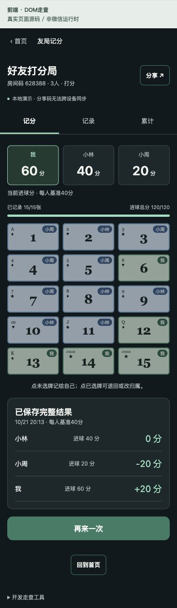

# 前端第四步：三人打分与后端联调

2026-10-21。按PRD第6节、UI-UX第8节及V4打分设计实现。需求和异常规则见[前后端交付](POINT-DELIVERY.md)，确定接口与部署记录见[后端交接](POINT-BACKEND-HANDOFF.md)。

## 已交付

| 功能点 | 验收行为 |
| --- | --- |
| 准备 | 确认包括本人的三名有效房间成员；固定本场名单。四人/精度未定项不开放。 |
| 当前进球分 | 三家初始0，本人置前并标“我”；显示已记录张数、进球总分及每人基准40，不把当前进球分误当累计输赢。 |
| 号码牌 | 1—15完整唯一，三列五行；Joker仍显示14/15。未分配点一下直接认领本人，成功后才加分。 |
| 归属修正 | 点已分配牌查看当前归属和最近修改人，选择退回公共区或改给本场三人；一次成功同时扣原分、加新分。初始记录人不被覆盖。 |
| 完整结果 | 未满15张不能保存；全记录且总分120才可主动保存。后端计算每人进球分−40，一次保存完整结果与累计。 |
| 保存后 | 号码牌只读，结果展示进球分和最终正负分；没有P05未定的结算后更正。 |
| 再来一次 | 重新确认名单，产生新activityId；新进球分0，原结果和累计保留，不自动清空。 |
| 记录与累计 | 分开查看完整结果、本场认领/修改记录；两者独立分页；累计直接读取服务端totals，不从一页历史推算。 |
| 网络与刷新 | 记分/累计在前台每4秒重读，隐藏或离开停止；历史页暂停轮询以保留分页。断网禁写，恢复只重读，不自动重发未知操作。 |

有效房间成员晚加入不改变本场名单/40分基准；允许查看、修正已有归属至本场三人，不允许认领给自己或保存本场结果。

## 异常边界落实

| 情形 | 控制与反馈 |
| --- | --- |
| 同一张牌重复点击/并发认领 | 本地同牌防重复；服务端检查cardRevision，只有一个成功，失败刷新最新归属。 |
| 不同牌同时操作 | 各自按cardRevision提交、显示局部保存状态，不用全局活动版本互相阻塞；回读按版本防止旧快照覆盖新状态。 |
| 保存与修改同时发生 | post带activityRevision；先修改则旧预览无法保存，先保存则不能改牌。 |
| 失败/断网 | 保留最后确认的牌与分数；不乐观显示假成功；错误提示可刷新重试。 |
| 丢响应/异常回执 | 按环境和本人持久化原requestId及完整命令；未知结果先锁定其他写入，允许关闭面板或确认原操作。重开后原ID恢复，不换ID重复记分。 |
| 本地日志写失败 | 发送前先保存日志，失败不发送。成功回执后清理日志失败则保留原请求可恢复。 |
| 旧活动/房间/面板 | 命令绑定原activityId、房间版本或卡版本。修正面板保存其打开时activityId；新活动到来后旧面板禁用。卸载后旧响应不能重开旧视图。 |
| 名单变化 | 准备时重新读取房间成员；开始后始终使用活动名单，不按房间总人数重算40分。 |
| 分页 | 只追加当前选择的结果或修改页，按activityId/requestId去重；拒绝不前进游标，不把其他分页首屏重复追加。 |
| 非法数据 | 云适配器验证DTO、15个唯一号码、归属属于本场、当前分与牌一致、完整结果合计120及减40公式、回执对应requestId/roomId/activityId。异常数据不覆盖已确认快照。 |

## 实现位置与复用

- `features/point/api.ts`：PointApi、基于shared的DTO、独立持久化Mock；Mock与云端隔离。
- `features/point/cloud.ts`：shared request schema、四个point action、activity.prepare、响应与回执校验。
- `features/point/store.ts`：Zustand、逐卡并发控制、独占准备/结算、请求日志、恢复、分页与版本保护。
- `PointFeature.tsx` / `point.css`：玩家进球分、PublicCard、进度、修正/名单面板、结果、记录和累计。复用BaseButton、ActionButton、BottomSheet、Notice、StatePanel。
- 原杀球号码素材索引移入共享`features/cards/images.ts`，杀球引用同步更新；宽牌由动态Text呈现号码、花色和归属，不拉伸整张窄牌图片。
- 新增Mock示例房间码 **628388**；既有本地房间、历史、最近列表不被覆盖。自己创建的打分房间只有本人，确认名单页面仍需三人才能开始。

## 前后端同步

已读取并向“后端”对话同步功能、权限、并发、幂等、历史、累计及新一局边界。后端按相同action提供shared类型，时间统一epoch毫秒；前端已使用真实契约，不再用“云端未接入”占位。

后端对话记录：26项后端测试通过，新增point_changes、point_results、point_totals已设ADMINONLY，api已部署Active。管理端探测返回“请从微信小程序访问”，只能证明启动与身份拦截正常。真实微信三成员调用、事务争用、同步及真机视觉仍需验收。

## 验证

- 前端44项测试通过，其中16项新增打分测试，覆盖固定名单、认领修正、原记录人、同/异牌竞争、保存竞态、失败写入、未知响应、日志清理失败、分页和旧页面隔离。
- 新增真实后端handler本地集成测试：CloudPointApi经shared schema调用createApi + MemoryStore，完成三身份创建/加入、prepare、15张认领、post以及再次prepare；真实DTO和回执验证通过。
- 全仓TypeScript检查通过；微信小程序Mock与cloud模式构建通过。测试使用MemoryStore不等于真实云事务并发测试。
- DOM走查：6号认领→改归小林→退回→重新认领；模拟转归成功但丢响应，面板可关闭、原请求恢复且不重复计分。
- DOM完整流程：进球分60/40/20保存为+20/0/−20；保存后只读；再来一次进球分归0，旧累计保留。
- 320视口15张牌约90.66×60px、430视口约127.33×60px，均为三列五行、无横向溢出。独立卡牌与按钮触控不低于44px。
- 本次截图为真实前端源码的DOM预览，不作为微信真机视觉证明。默认构建仍为隔离Mock；云端模式需使用build:miniapp:cloud并以真实微信身份运行。

